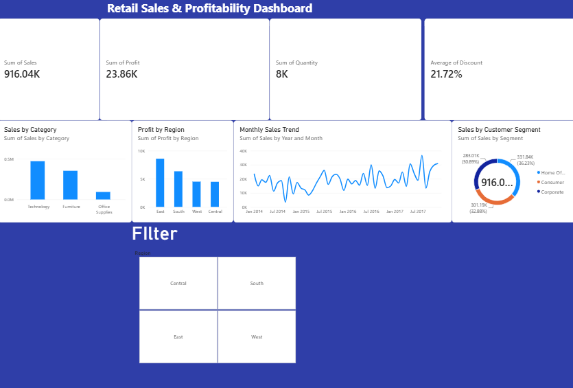

# Retail Sales & Profitability Analysis

An end-to-end analysis of retail sales data: cleaning in Excel, analysis in MySQL, and an interactive Power BI dashboard that shows where the business earns money and where discounts hurt profit.

## Business Questions
- How much did the business sell, and how much profit did it make?
- Which product categories, regions, and customer segments drive sales and profit?
- How do sales change month to month?
- Is the average discount affecting profitability?

## Tools Used
Excel (cleaning and validation) | MySQL (analysis) | Power BI (dashboard and KPIs)

## Key Numbers
| KPI | Value |
|---|---|
| Total Sales | 916.04K |
| Total Profit | 23.86K |
| Quantity Sold | 8K |
| Average Discount | 21.72% |
| Profit Margin (Profit / Sales) | about 2.6% |

**Sales by customer segment:** Consumer 331.84K (36.23%) | Corporate 301.19K (32.88%) | Home Office 283.01K (30.89%)

## Key Insights
- Profit is only about 2.6% of sales while the average discount is 21.72%, so heavy discounting is a likely drag on margin.
- Sales are spread fairly evenly across the three customer segments; no single segment dominates.
- The monthly sales trend shows clear ups and downs from 2014 to 2017, which makes it useful for spotting peak and slow months.

## Project Workflow
1. **Clean and validate (Excel):** removed duplicate records, handled blank (missing) values, and standardized date formats.
2. **Analyze (MySQL):** queries on sales, profit, product category, customer segment, and region (`retail_sales_project.sql`).
3. **Visualize (Power BI):** KPI cards, sales by category, profit by region, monthly sales trend, sales by segment, and a region filter (`Retail_Sales_Dashboard.pbix`).

## Files in this Repository
| File | Description |
|---|---|
| `Retail_Sales_Analysis.xlsx` | Cleaned retail sales data |
| `retail_sales_project.sql` | MySQL analysis queries |
| `Retail_Sales_Dashboard.pbix` | Power BI dashboard |
| `dashboard.png` | Dashboard screenshot |

## Dataset
Source: Kaggle (retail sales dataset)

## How to Open
Download `Retail_Sales_Dashboard.pbix` and open it in Power BI Desktop.

## Author
Mohammed Muzammil | [LinkedIn](https://linkedin.com/in/mmuzammil39) | muzammilmohammad330@gmail.com
